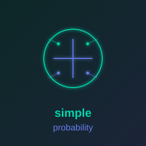

<p align="center">
  
</p>

<h1 align="center">simple_probability</h1>

<p align="center">
  <a href="https://simple-eiffel.github.io/simple_probability/">Documentation</a> •
  <a href="https://github.com/simple-eiffel/simple_probability">GitHub</a>
</p>

<p align="center">
  
  
  
  
  
  
</p>

Type-safe probability distributions and Bayesian inference for Eiffel.

Part of the [Simple Eiffel](https://github.com/simple-eiffel) ecosystem.

## Status

✅ **Production Ready** — v1.0.0
- Comprehensive test suite
- Design by Contract throughout
- Full Bayesian inference support

## Overview

**simple_probability** provides type-safe probability distributions and Bayesian inference for Eiffel.

It offers **multiple continuous and discrete distributions**, **PDF/PMF and CDF evaluation**, **inverse CDF sampling**, **Bayesian conjugate priors**, and **credible intervals**.

## Distributions

- **Continuous:** Normal (Gaussian), Uniform, Exponential, Beta
- **Discrete:** Binomial
- **All distributions:** PDF/PMF, CDF, ICDF (inverse CDF), sampling

## Quick Start

```eiffel
local
    l_dist: NORMAL_DISTRIBUTION
do
    create l_dist.make (100.0, 15.0)  -- mean, std_dev
    print (l_dist.pdf (95.0))         -- Probability density
    print (l_dist.sample)             -- Random sample
end
```

## Features

- **Multiple Distributions** - Normal, Uniform, Exponential, Beta, Binomial
- **Complete API** - PDF/PMF, CDF, ICDF, sampling for all distributions
- **Bayesian Inference** - Conjugate priors, credible intervals, posterior estimation
- **Design by Contract** - Full preconditions, postconditions, invariants
- **Void-Safe** - void_safety="all" prevents null pointer errors
- **SCOOP Compatible** - Ready for concurrent execution (future)

## Installation

1. Set the ecosystem environment variable (one-time setup for all simple_* libraries):
```
SIMPLE_EIFFEL=D:\prod
```

2. Add to ECF:
```xml
<library name="simple_probability" location="$SIMPLE_EIFFEL/simple_probability/simple_probability.ecf"/>
```

## License

MIT License - see [LICENSE](LICENSE) file.

---

Part of the [Simple Eiffel](https://github.com/simple-eiffel) ecosystem.
